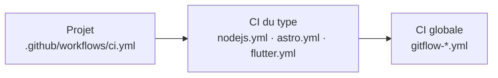
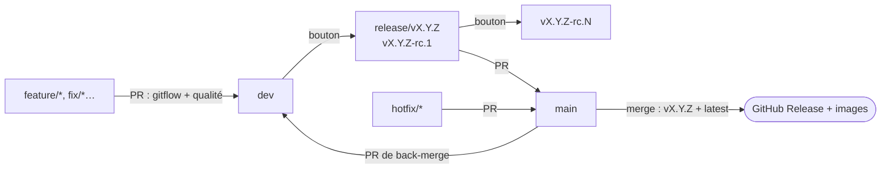

# Github-ci

La CI de mes projets : git flow imposé, qualité vérifiée à chaque pull request, release candidates à la demande et versions finales publiées au merge sur `main`. Le déploiement reste manuel.

Un projet l'importe avec **un seul fichier** de quelques lignes. Toute la logique reste ici.

## Les trois niveaux



| Niveau | Rôle | Dossier |
|---|---|---|
| **Projet** | Choisit son type et rien d'autre | Fichier d'exemple dans `<type>/example/ci.yml` |
| **Type** | Ce qui dépend de la techno : installation, lint, types, tests, build Android, paquet npm… | [nodejs/](nodejs/), [astro/](astro/), [flutter/](flutter/) |
| **Gitflow** | Ce qui est commun à tous : règles de branches, messages de commit, version, application ou librairie, image Docker, GitHub Release, back-merge | [gitflow/](gitflow/) |

Chaque type branche les mêmes briques gitflow dans le même ordre. Ajouter un type, c'est écrire son job `quality` et recopier ce câblage.

## Application ou librairie

Le nom du dépôt dit ce qu'est le projet : `mon-projet-app` est une application, `mon-projet-lib` une librairie. Une application est publiée en image Docker (et en APK/AAB pour Flutter), une librairie en paquet npm pour Node.js, ou par son seul tag git pour Flutter. Le détail est dans [gitflow/README.md → Application ou librairie](gitflow/README.md#application-ou-librairie).

## Le flux



| Moment | Ce qui se passe |
|---|---|
| Pull request | Règles du git flow, messages de commit (Conventional Commits), qualité du type |
| Bouton **Run workflow** sur `dev` | Qualité, puis release candidate `vX.Y.Z-rc.1` : image Docker ou paquet, pre-release GitHub, branche `release/vX.Y.Z` et sa pull request vers `main` |
| Bouton sur `release/vX.Y.Z` ou `hotfix/*` | Qualité, puis release candidate suivante `vX.Y.Z-rc.N` |
| Merge sur `main` | Qualité, puis version finale `vX.Y.Z` : image Docker `X.Y.Z` + `latest` ou paquet, GitHub Release, pull request de back-merge `main` → `dev` |

Les détails (règles, calcul de version, réglages du dépôt) sont dans [gitflow/README.md](gitflow/README.md).

## Installer dans un projet

1. Suivre le README du type : [Node.js](nodejs/README.md), [Astro](astro/README.md) ou [Flutter](flutter/README.md).
2. Faire les réglages du dépôt, une fois par projet : [gitflow/README.md → Installer dans un projet](gitflow/README.md#installer-dans-un-projet).

## Organisation de ce dépôt

```text
.github/workflows/          Workflows réutilisables (GitHub impose cet emplacement)
├── gitflow-checks.yml           ┐
├── gitflow-prepare-release.yml  │ appartiennent à gitflow/
├── gitflow-docker-image.yml     │
├── gitflow-publish-release.yml  ┘
├── nodejs.yml                   → appartient à nodejs/
├── astro.yml                    → appartient à astro/
└── flutter.yml                  → appartient à flutter/
gitflow/
├── scripts/                La logique du git flow, en bash, testable en local
├── tests/                  Tests des scripts
└── rulesets/               Protections de branches à importer dans chaque projet
nodejs/ · astro/ · flutter/
└── example/                Fichiers à copier dans un projet
archive/                    Anciennes versions, conservées pour mémoire
```

**Pourquoi les workflows ne sont pas dans les sous-dossiers ?** GitHub ne trouve un workflow réutilisable (`uses: owner/repo/.github/workflows/x.yml@ref`) que dans le dossier `.github/workflows/` à la racine du dépôt. Ils sont donc à la racine, préfixés par leur propriétaire. Les composite actions, elles, peuvent vivre n'importe où : c'est pourquoi les scripts restent dans `gitflow/scripts/`.

## Publier ce dépôt

- Ce dépôt doit s'appeler `FloRobart/Github-ci`. Toutes les références internes pointent sur `FloRobart/Github-ci/...@main`.
- S'il est privé : Settings → Actions → General → Access → **Accessible from repositories owned by the user**.
- Les projets suivent `@main` : une modification mergée sur `main` s'applique à tous les projets dès leur prochain lancement.

## Tester

```bash
gitflow/tests/run-tests.sh
```

Les tests créent des dépôts git jetables et vérifient le calcul de version, les règles de branches, les messages de commit et le plan de release. Ils n'ont besoin ni de réseau ni de GitHub.

## Séparer en plusieurs dépôts plus tard

Chaque fichier a déjà un seul propriétaire, la séparation est donc mécanique :

1. Créer un dépôt par dossier, par exemple `FloRobart/ci-gitflow`, `FloRobart/ci-nodejs`, etc.
2. Y déplacer le contenu du dossier, ainsi que ses workflows de `.github/workflows/`.
3. Remplacer les références `FloRobart/Github-ci/...` :
   - `FloRobart/Github-ci/.github/workflows/gitflow-*.yml` devient `FloRobart/ci-gitflow/.github/workflows/gitflow-*.yml` ;
   - `FloRobart/Github-ci/gitflow/scripts` devient `FloRobart/ci-gitflow/scripts`.
4. Mettre à jour les fichiers `ci.yml` des projets.
