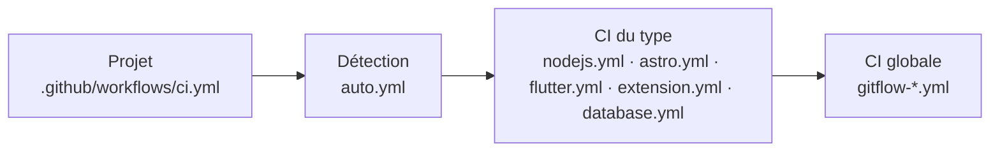

# Github-ci

La CI de mes projets : git flow imposé, qualité vérifiée à chaque pull request, release candidates à la demande et versions finales publiées au merge sur `main`. Le déploiement reste manuel.

Un projet l'importe avec **un seul fichier** de quelques lignes, **le même pour tous les projets** : la CI détecte toute seule de quel type de projet il s'agit. Toute la logique reste ici.

## Les quatre niveaux



| Niveau | Rôle | Dossier |
|---|---|---|
| **Projet** | Le même `ci.yml` partout, qui appelle `auto.yml` | [auto/example/ci.yml](auto/example/ci.yml) |
| **Auto** | Détecte le type du projet et lance la CI de ce type | [auto/](auto/) |
| **Type** | Ce qui dépend de la techno : installation, lint, types, tests, build Android, Google Play, paquet npm ou pub.dev, stores d'extensions, migrations de base de données… | [nodejs/](nodejs/), [astro/](astro/), [flutter/](flutter/), [extension/](extension/), [database/](database/) |
| **Gitflow** | Ce qui est commun à tous : règles de branches, messages de commit, version, détection du type, image Docker, GitHub Release, back-merge | [gitflow/](gitflow/) |

Chaque niveau reste utilisable seul : un projet peut appeler directement une CI de type, et une CI de type appelle les briques gitflow. Chaque type branche les mêmes briques gitflow dans le même ordre. Ajouter un type, c'est écrire son job `quality`, recopier ce câblage, puis ajouter sa règle à la détection et son job à `auto.yml`.

## Type de projet

Les fichiers à la racine et le suffixe du nom du dépôt disent ce qu'est le projet :

| Le projet a… | Type | Publié |
|---|---|---|
| `pubspec.yaml` + `Dockerfile`, ou un nom en `-app` | Application Flutter | Image Docker (avec un `Dockerfile`), APK de debug, ou APK et AAB signés puis Google Play s'il y a les secrets |
| `pubspec.yaml` seul, ou un nom en `-lib` | Librairie Flutter | GitHub Release, puis pub.dev |
| `package.json` + `Dockerfile` | Application Node.js, ou site Astro avec la dépendance `astro` | Image Docker |
| `package.json` + un nom en `-extension` | Extension navigateur | Archive `.zip`, puis Chrome Web Store et addons.mozilla.org |
| `package.json` + un nom en `-lib` | Librairie Node.js | Paquet npm |
| `Dockerfile` + un nom en `-database` | Migrations de base de données (dbmate) | Image Docker `…-migrations` |

Les règles exactes et les cas refusés sont dans [gitflow/README.md → Type de projet](gitflow/README.md#type-de-projet).

## Le flux


| Moment | Ce qui se passe |
|---|---|
| Pull request | Règles du git flow, messages de commit (Conventional Commits), qualité du type |
| Bouton **Run workflow** sur `dev` | Qualité, puis release candidate `vX.Y.Z-rc.1` : image Docker, paquet ou fichiers de l'application, pre-release GitHub, branche `release/vX.Y.Z` et sa pull request vers `main` |
| Bouton sur `release/vX.Y.Z` ou `hotfix/*` | Qualité, puis release candidate suivante `vX.Y.Z-rc.N` |
| Merge sur `main` | Qualité, puis version finale `vX.Y.Z` : image Docker `X.Y.Z` + `latest`, paquet ou fichiers de l'application, GitHub Release, pull request de back-merge `main` → `dev`, puis envoi aux stores (Google Play, pub.dev, Chrome Web Store, addons.mozilla.org) dont les secrets existent |

Les détails (règles, calcul de version, réglages du dépôt) sont dans [gitflow/README.md](gitflow/README.md).

## Installer dans un projet

1. Copier [auto/example/ci.yml](auto/example/ci.yml) dans le projet, sous `.github/workflows/ci.yml` : voir [auto/README.md](auto/README.md).
2. Suivre les prérequis du README du type : [Node.js](nodejs/README.md), [Astro](astro/README.md), [Flutter](flutter/README.md), [Extension](extension/README.md) ou [Database](database/README.md).
3. Faire les réglages du dépôt, une fois par projet : [gitflow/README.md → Installer dans un projet](gitflow/README.md#installer-dans-un-projet).

## Organisation de ce dépôt

```text
.github/workflows/          Workflows réutilisables (GitHub impose cet emplacement)
├── auto.yml                     → appartient à auto/
├── gitflow-checks.yml           ┐
├── gitflow-prepare-release.yml  │ appartiennent à gitflow/
├── gitflow-docker-image.yml     │
├── gitflow-publish-release.yml  ┘
├── nodejs.yml                   → appartient à nodejs/
├── astro.yml                    → appartient à astro/
├── flutter.yml                  → appartient à flutter/
├── extension.yml                → appartient à extension/
├── database.yml                 → appartient à database/
└── self-tests.yml               → CI de ce dépôt, jamais appelée par les projets
gitflow/
├── scripts/                La logique du git flow et la détection du type, en bash, testables en local
├── tests/                  Tests des scripts
└── rulesets/               Protections de branches à importer dans chaque projet
auto/ · nodejs/ · astro/ · flutter/ · extension/ · database/
└── example/                Fichiers à copier dans un projet
archive/                    Anciennes versions, conservées pour mémoire
```

**Pourquoi les workflows ne sont pas dans les sous-dossiers ?** GitHub ne trouve un workflow réutilisable (`uses: owner/repo/.github/workflows/x.yml@ref`) que dans le dossier `.github/workflows/` à la racine du dépôt. Ils sont donc à la racine, préfixés par leur propriétaire. Les composite actions, elles, peuvent vivre n'importe où : c'est pourquoi les scripts restent dans `gitflow/scripts/`.

## Publier ce dépôt

- Ce dépôt doit s'appeler `FloRobart/github-ci`. Toutes les références internes pointent sur `FloRobart/github-ci/...@main`.
- S'il est privé : Settings → Actions → General → Access → **Accessible from repositories owned by the user**.
- Les projets suivent `@main` : une modification mergée sur `main` s'applique à tous les projets dès leur prochain lancement.

## Tester

```bash
gitflow/tests/run-tests.sh
```

Les tests créent des dépôts git et des projets jetables, et vérifient la détection du type de projet, le calcul de version, les règles de branches, les messages de commit et le plan de release. Ils n'ont besoin ni de réseau ni de GitHub, seulement de `jq`.

Lint, avec [shellcheck](https://github.com/koalaman/shellcheck) et [actionlint](https://github.com/rhysd/actionlint) installés :

```bash
shellcheck --external-sources --source-path=SCRIPTDIR gitflow/scripts/*.sh gitflow/tests/*.sh
```

```bash
actionlint .github/workflows/*.yml ./*/example/ci.yml
```

[self-tests.yml](.github/workflows/self-tests.yml) lance ces trois contrôles sur chaque pull request de ce dépôt et sur `main`. Il n'a pas de `workflow_call` : les projets qui importent Github-ci ne le lancent jamais. Il teste le code de la pull request elle-même, jamais la version `@main`.

Ne sont pas couverts : l'enchaînement réel des workflows réutilisables appelés par un projet, les scripts qui écrivent sur GitHub (`create-branch.sh`, `open-pull-request.sh`, `create-github-release.sh`) et les envois aux stores (Google Play, pub.dev, Chrome Web Store, addons.mozilla.org). Seul un vrai projet de test les vérifie.

## Séparer en plusieurs dépôts plus tard

Chaque fichier a déjà un seul propriétaire, la séparation est donc mécanique :

1. Créer un dépôt par dossier, par exemple `FloRobart/ci-gitflow`, `FloRobart/ci-auto`, `FloRobart/ci-nodejs`, etc.
2. Y déplacer le contenu du dossier, ainsi que ses workflows de `.github/workflows/`.
3. Remplacer les références `FloRobart/github-ci/...` :
   - `FloRobart/github-ci/.github/workflows/gitflow-*.yml` devient `FloRobart/ci-gitflow/.github/workflows/gitflow-*.yml` ;
   - `FloRobart/github-ci/gitflow/scripts` devient `FloRobart/ci-gitflow/scripts`.
4. Mettre à jour les fichiers `ci.yml` des projets.
