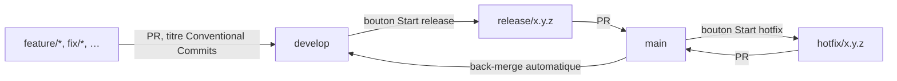

# Github-ci

Pipelines GitHub Actions réutilisables qui imposent un Git workflow unique à tous les projets : branches protégées, versions calculées automatiquement à partir des titres de pull requests, release candidates, publication des images et des releases, back-merge automatique.

Un projet n'embarque que cinq petits fichiers d'appel ; toute la logique reste ici.

> Le pipeline publie des **artefacts** (GitHub Release, images Docker, archives d'extension). Il ne déploie rien : la mise en production sur le serveur reste manuelle.

## Le flux en bref



| Branche | Rôle | Ce qu'elle accepte |
|---|---|---|
| `main` | La production | Uniquement des pull requests venant de `release/x.y.z` ou `hotfix/x.y.z` |
| `develop` | L'intégration | Des pull requests venant de n'importe quelle branche |
| `release/x.y.z` | Une version en préparation | Créée par le bouton **Start release** |
| `hotfix/x.y.z` | Un correctif urgent de la production | Créée par le bouton **Start hotfix** |

Le détail du flux, les cas particuliers et la signification des messages d'erreur sont dans [docs/git-workflow.md](docs/git-workflow.md).

## Installer le pipeline dans un projet

La marche à suivre complète est dans [docs/installation.md](docs/installation.md). En résumé :

1. Une seule fois : publier ce dépôt et créer la GitHub App d'automatisation.
2. Dans le projet : copier les cinq fichiers du modèle correspondant, depuis [templates/](templates/).
3. Lancer `scripts/setup-repository.sh` pour protéger les branches.

| Type de projet | Modèle | Ce qui est publié |
|---|---|---|
| API Node.js avec Dockerfile | [templates/api-node](templates/api-node/.github/workflows) | Image Docker sur GHCR et Docker Hub |
| Application Flutter | [templates/app-flutter](templates/app-flutter/.github/workflows) | Image Docker de la version web sur GHCR et Docker Hub |
| Extension de navigateur | [templates/extension](templates/extension/.github/workflows) | Archives jointes à la GitHub Release, envoi optionnel au Chrome Web Store et à addons.mozilla.org |

## Organisation du dépôt

Chaque dossier a une seule responsabilité, et chaque brique peut être utilisée sans les autres.

```text
.github/workflows/   Workflows réutilisables : une étape du flux ou un type de publication par fichier
actions/             Actions composites : briques utilisables seules dans n'importe quel job
toolkit/             Scripts Node.js appelés par les workflows et les actions
  core/              Règles pures, sans accès extérieur (versions, titres, branches, changelog)
  infrastructure/    Accès à git, à GitHub, aux fichiers du projet et aux rapports du runner
  services/          Assemblage de plusieurs accès (historique des versions)
  commands/          Un script par étape du flux
  tests/             Tests unitaires
templates/           Fichiers d'appel à copier dans un projet, par type de projet
rulesets/            Règles de protection des branches, importables dans GitHub
scripts/             Script d'installation à lancer une fois par projet
docs/                Documentation
```

### Workflows réutilisables

Le flux Git, identique pour tous les projets :

| Fichier | Rôle | Déclencheur attendu côté projet |
|---|---|---|
| `pull-request-policy.yml` | Vérifie le titre, les branches source et cible, et la version à publier | `pull_request` |
| `start-release-or-hotfix.yml` | Crée la branche `release/x.y.z` ou `hotfix/x.y.z` et sa pull request | `workflow_dispatch` |
| `release-candidate.yml` | Publie `vX.Y.Z-rc.N` en pre-release | `workflow_dispatch` |
| `publish-release.yml` | Crée le tag `vX.Y.Z` et la GitHub Release | `push` sur `main` |
| `back-merge.yml` | Reporte la version publiée vers `develop` et vers la release en cours | Après `publish-release.yml` |

Les vérifications et les publications, à choisir selon le projet :

| Fichier | Rôle |
|---|---|
| `node-quality.yml` | Installe un projet Node.js, puis build, lint et tests |
| `flutter-quality.yml` | Installe un projet Flutter, puis analyse et tests |
| `docker-publish.yml` | Construit une image et la pousse sur GHCR et Docker Hub |
| `extension-build.yml` | Construit, vérifie et archive une extension de navigateur |
| `extension-publish.yml` | Envoie l'extension au Chrome Web Store et à addons.mozilla.org |

Les paramètres de chaque workflow sont décrits en tête de son fichier, dans le bloc `inputs`.

### Actions composites

| Action | Rôle |
|---|---|
| `actions/validate-pull-request-title` | Refuse un titre qui ne respecte pas Conventional Commits |
| `actions/validate-branch-policy` | Refuse une pull request vers la production qui ne vient pas d'une branche release ou hotfix |
| `actions/authenticate-automation` | Connecte git et la GitHub CLI en tant que GitHub App d'automatisation |

Exemple d'utilisation d'une seule brique, sans le reste du flux :

```yaml
- uses: FloRobart/Github-ci/actions/validate-pull-request-title@v1
  with:
    title: ${{ github.event.pull_request.title }}
```

## Calcul de la version

La version d'une release est déduite des titres des pull requests mergées depuis la dernière version publiée.

| Titre de pull request | Montée de version |
|---|---|
| `feat(api)!: …` ou corps contenant `BREAKING CHANGE:` | Majeure : `1.4.2` → `2.0.0` |
| `feat: …` | Mineure : `1.4.2` → `1.5.0` |
| Tout autre type (`fix`, `chore`, `docs`, `refactor`, …) | Correctif : `1.4.2` → `1.4.3` |

La montée la plus forte l'emporte. Un hotfix applique toujours une montée de correctif. Le bouton **Start release** permet aussi de forcer `patch`, `minor` ou `major`.

## Faire évoluer ce dépôt

Les projets référencent ce dépôt par le tag `v1`. Une modification n'atteint donc les projets qu'une fois ce tag déplacé :

```bash
git tag --force v1
```

```bash
git push --force origin v1
```

Les scripts sont toujours exécutés dans la version exacte du workflow qui les appelle : il n'y a aucune autre référence de version à tenir à jour.

Pour essayer une modification avant de déplacer `v1`, un projet de test peut pointer sur une branche : `uses: FloRobart/Github-ci/.github/workflows/publish-release.yml@ma-branche`.

Les tests unitaires se lancent avec Node.js 20 ou plus récent, sans installation :

```bash
cd toolkit && node --test
```

## Ce qui n'est pas encore couvert

- **Base de données** : aucune migration n'est exécutée ni publiée.
- **Stores mobiles** : la publication sur le Play Store n'existe pas encore. Le numéro de build du `pubspec.yaml` est déjà incrémenté à chaque version, ce qu'un store exige.
- **Déploiement** : volontairement absent.
