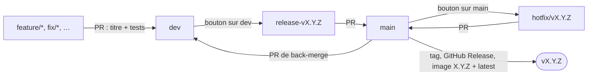

# Github-ci

Un gitflow automatisé pour les projets Node.js et Flutter qui publient des images Docker sur GHCR et Docker Hub.

Un projet l'importe avec **un seul fichier de 8 lignes**. Toute la logique reste dans ce dépôt, à raison d'un fichier par étape.

## Le flux



| Moment | Ce qui se passe tout seul |
|---|---|
| Pull request | Titre vérifié (Conventional Commits), tests lancés. `main` n'accepte que les branches `release-vX.Y.Z` et `hotfix/vX.Y.Z`, et seulement si leur version est plus récente que la dernière publiée |
| Merge d'une release ou d'un hotfix dans `main` | Tag `vX.Y.Z`, GitHub Release avec notes générées, image Docker `X.Y.Z` + `latest`, branche de release ou de hotfix supprimée, pull request `main` → `dev` ouverte |

### Le bouton

Il n'y a qu'un bouton : onglet Actions → Gitflow → **Run workflow**. Ce qu'il fait dépend de la branche choisie.

| Branche choisie | Ce que fait le bouton |
|---|---|
| `dev` | **Crée une release** : version suivante calculée, branche `release-vX.Y.Z` créée, version écrite dans `package.json` ou `pubspec.yaml`, pull request vers `main` ouverte |
| `main` | **Crée un hotfix** : même chose avec une version corrective et une branche `hotfix/vX.Y.Z` |
| `release-vX.Y.Z` ou `hotfix/vX.Y.Z` | **Publie une release candidate** : tag `vX.Y.Z-rc.N` et image Docker `X.Y.Z-rc.N` |
| Toute autre branche | Refusé |

Une release candidate n'est jamais publiée toute seule : uniquement par ce bouton, quand vous en avez besoin.

### Une seule version à la fois

Tant qu'une branche `release-vX.Y.Z` ou `hotfix/vX.Y.Z` existe, le bouton refuse d'en créer une autre, sur `dev` comme sur `main`. Deux versions ouvertes en même temps pourraient être publiées dans le désordre, et `latest` pointerait alors sur une version plus ancienne.

- La branche est supprimée automatiquement une fois sa version publiée.
- Pour abandonner une version : fermer sa pull request et supprimer sa branche.
- Pour un correctif urgent pendant une release : le pousser directement sur la branche `release-vX.Y.Z`. Il est publié avec elle.

Deux clics rapprochés sur le bouton, ou deux merges rapprochés sur `main`, ne se marchent pas dessus : le second attend la fin du premier.

## Installer dans un projet

### 1. Le fichier d'import

Copier [example/gitflow.yml](example/gitflow.yml) dans le projet, sous `.github/workflows/gitflow.yml`, sur `main` **et** sur `dev` :

```yaml
name: Gitflow
on:
  pull_request: { types: [opened, edited, synchronize, reopened] }
  push: { branches: [main] }
  workflow_dispatch:
permissions: { contents: write, packages: write, pull-requests: write }
jobs:
  gitflow: { uses: FloRobart/Github-ci/.github/workflows/gitflow.yml@main, secrets: inherit }
```

Le job doit garder le nom `gitflow` : les rulesets attendent des vérifications dont le nom commence par `gitflow / …`.

Le projet doit avoir un `Dockerfile` à la racine, et un `package.json` ou un `pubspec.yaml` : le type de projet est détecté tout seul. Un projet Node.js est installé avec npm : `npm ci` s'il a un `package-lock.json` (conseillé, plus rapide et reproductible), `npm install` sinon.

### 2. Les réglages du dépôt, une fois par projet

| Où | Quoi |
|---|---|
| Settings → Secrets and variables → Actions | Secrets `DOCKERHUB_USERNAME` et `DOCKERHUB_TOKEN`. Sans eux, seule l'image GHCR est publiée. |
| Settings → Actions → General → Workflow permissions | Cocher **Allow GitHub Actions to create and approve pull requests**. |
| Settings → General → Pull Requests → Allow squash merging | Dans **Default commit message**, choisir **Default to pull request title** (ou **Default to pull request title and description**). Sinon, une pull request d'un seul commit est squashée avec le message de ce commit au lieu de son titre, et le calcul de version ne lit pas le bon texte. |
| Settings → Rules → Rulesets → New ruleset → Import a ruleset | Importer [rulesets/dev-branch.json](rulesets/dev-branch.json) et [rulesets/main-branch.json](rulesets/main-branch.json). |
| Settings → General → Pull Requests | Conseillé : cocher **Automatically delete head branches**, pour les branches `feature/*`, `fix/*`… Les branches de release et de hotfix sont supprimées dans tous les cas. |

Les rulesets sont les garde-fous : plus de push direct sur `dev` ni sur `main`, pull request obligatoire, vérifications obligatoires, et merge commit imposé sur `main`.

> Les rulesets attendent trois vérifications produites par GitHub Actions : `gitflow / Gitflow branches / Check`, `gitflow / Pull request title / Check` et `gitflow / Tests / Run`. Si une pull request reste bloquée sur « Expected — Waiting for status to be reported », vérifier que le job du fichier d'import s'appelle bien `gitflow`, puis comparer ces noms avec ceux affichés en bas de la pull request.

### 3. Le jeton `GITFLOW_TOKEN`, facultatif mais conseillé

GitHub ne lance aucun workflow sur une pull request ouverte par le jeton par défaut d'Actions. Sans réglage, les vérifications de la pull request de release et de celle de back-merge ne démarrent donc pas : il faut fermer puis rouvrir la pull request.

Pour l'éviter, créer un *fine-grained personal access token* (Settings du compte → Developer settings) avec les permissions **Contents**, **Pull requests** et **Workflows** en lecture et écriture, et l'enregistrer dans le secret `GITFLOW_TOKEN` du projet. Il est utilisé automatiquement dès qu'il existe.

### 4. Un projet qui a déjà une version

Sans aucun tag `vX.Y.Z`, la première release est `0.1.0`. Pour qu'un projet existant reparte de sa version actuelle, par exemple `2.3.0`, créer une fois le tag `v2.3.0` sur `main` (onglet Releases → Draft a new release, ou `git tag v2.3.0 main` puis `git push origin v2.3.0`). La release suivante sera `2.3.1`, `2.4.0` ou `3.0.0`.

## Utiliser au quotidien

1. **Développer** : ouvrir une pull request vers `dev` avec un titre du type `feat: ajoute l'export CSV`.
2. **Créer une release** : bouton sur la branche `dev`.
3. **Essayer**, si besoin : bouton sur la branche `release-vX.Y.Z` pour obtenir l'image `X.Y.Z-rc.N`. Un correctif se pousse sur cette même branche.
4. **Publier** : merger la pull request de release dans `main`.
5. **Resynchroniser** : merger la pull request `main` → `dev` avec **Create a merge commit**.

Pour un **hotfix** : quand aucune release n'est en cours, bouton sur la branche `main`, pousser le correctif sur la branche `hotfix/vX.Y.Z` créée, puis reprendre à l'étape 3. Pendant une release, pousser plutôt le correctif sur la branche de release (voir [Une seule version à la fois](#une-seule-version-à-la-fois)).

Si la publication échoue en cours de route (image Docker, back-merge…), relancer le workflow depuis l'onglet Actions (**Re-run jobs**) : ce qui a déjà été fait est conservé.

## Calcul de la version

La version suivante vient des titres des pull requests mergées dans `dev` depuis le dernier tag `vX.Y.Z`. Seuls les commits de `dev` lui-même sont lus (un par pull request), pas ceux à l'intérieur des pull requests. La montée la plus forte l'emporte.

| Titre de pull request | Montée |
|---|---|
| `feat(api)!: …`, `fix!: …` ou une ligne `BREAKING CHANGE: …` | Majeure : `1.4.2` → `2.0.0` |
| `feat: …` | Mineure : `1.4.2` → `1.5.0` |
| Tout le reste (`fix`, `chore`, `docs`, `refactor`…) | Corrective : `1.4.2` → `1.4.3` |

- Un hotfix est toujours une montée corrective.
- Un projet sans aucun tag commence à `0.1.0` (voir [Un projet qui a déjà une version](#4-un-projet-qui-a-déjà-une-version)).
- Une montée majeure en `0.x` passe à `1.0.0` : `0.4.2` → `1.0.0`.
- Les tags sont la référence : la version écrite dans `package.json` ou `pubspec.yaml` est mise à jour par la release, elle ne sert jamais au calcul.

## Les fichiers

Tout est dans [.github/workflows](.github/workflows). [gitflow.yml](.github/workflows/gitflow.yml) est le seul fichier appelé par les projets : il décrit le flux et appelle les autres.

| Fichier | Rôle |
|---|---|
| [gitflow.yml](.github/workflows/gitflow.yml) | Le chef d'orchestre : dit quelle étape tourne à quel moment |
| [check-pull-request-title.yml](.github/workflows/check-pull-request-title.yml) | Vérifie que le titre respecte Conventional Commits |
| [check-gitflow-branches.yml](.github/workflows/check-gitflow-branches.yml) | Les règles de branches : bouton refusé hors de `dev`, `main`, `release-vX.Y.Z` et `hotfix/vX.Y.Z`, une seule version à la fois, `main` uniquement depuis une release ou un hotfix plus récent que la dernière version |
| [detect-project-type.yml](.github/workflows/detect-project-type.yml) | Détecte Node.js ou Flutter |
| [run-tests.yml](.github/workflows/run-tests.yml) | Installe le projet et lance ses tests |
| [compute-next-version.yml](.github/workflows/compute-next-version.yml) | Calcule la version suivante |
| [create-release-branch.yml](.github/workflows/create-release-branch.yml) | Crée la branche de release ou de hotfix, écrit la version, ouvre la pull request vers `main` |
| [publish-release-candidate.yml](.github/workflows/publish-release-candidate.yml) | Sur demande : crée le tag `vX.Y.Z-rc.N` et publie l'image correspondante |
| [publish-release.yml](.github/workflows/publish-release.yml) | Crée le tag final, la GitHub Release et l'image finale, supprime la branche mergée, ouvre le back-merge |
| [build-docker-images.yml](.github/workflows/build-docker-images.yml) | Construit les images et les pousse sur GHCR et Docker Hub. L'image GHCR est rattachée au dépôt du projet |

## Options

Deux paramètres facultatifs, à ajouter au fichier d'import :

```yaml
jobs:
  gitflow:
    uses: FloRobart/Github-ci/.github/workflows/gitflow.yml@main
    secrets: inherit
    with:
      node-version: '22'
      docker-images: '[{"name": "floraccess-db", "context": "Database"}, {"name": "floraccess-server", "context": "."}]'
```

| Paramètre | Par défaut | Rôle |
|---|---|---|
| `node-version` | `24` | Version de Node.js utilisée pour les tests |
| `docker-images` | Une image, du nom du dépôt, construite depuis la racine | Liste des images. Chaque image accepte `name`, `context` et `dockerfile`. Le chemin donné dans `dockerfile` part de la racine du dépôt, pas du `context` : par exemple `"Database/Dockerfile.prod"` |

## Publier ce dépôt

Le contenu de ce dossier doit être à la **racine** du dépôt `FloRobart/Github-ci` : GitHub ne lit les workflows réutilisables que dans `.github/workflows`.

Si le dépôt est privé : Settings → Actions → General → Access → **Accessible from repositories owned by the user**.

Les projets pointent sur `@main` : une modification poussée ici s'applique à tous les projets dès leur prochain lancement.

## Ce qui n'est pas couvert

- **Déploiement** : seules des images et des releases sont publiées, rien n'est déployé.
