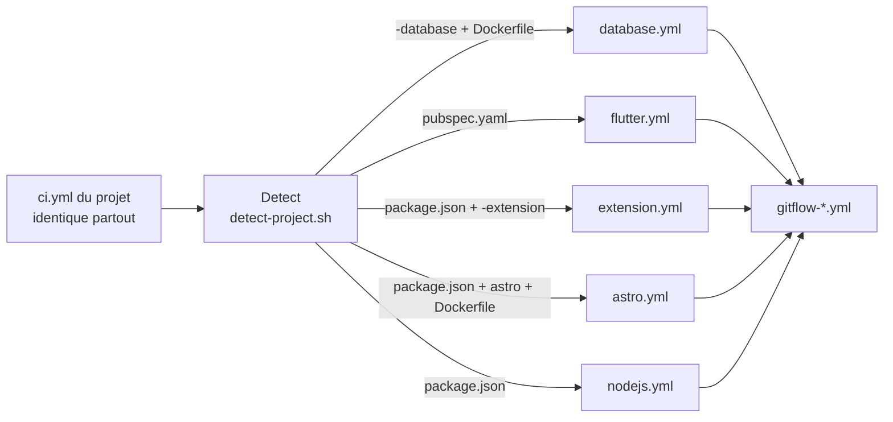

# Auto

Le point d'entrée unique : **le même `ci.yml` dans tous les projets**. Il détecte le type du projet, puis lance la CI de ce type, git flow compris.



Le workflow est [.github/workflows/auto.yml](../.github/workflows/auto.yml). Il ne fait que choisir : toute la logique reste dans les CI de type et dans [gitflow](../gitflow/README.md).

## Ce qui est détecté

| Le projet a… | CI lancée | Ce qui est publié |
|---|---|---|
| `pubspec.yaml` + `Dockerfile`, ou un nom en `-app` | [Flutter](../flutter/README.md), application | Image Docker de la version web (s'il y a un `Dockerfile`) et Android : APK signé avec la clé de debug sans les secrets de signature, APK et AAB signés puis Google Play avec |
| `pubspec.yaml` seul, ou un nom en `-lib` | [Flutter](../flutter/README.md), librairie | Tag et GitHub Release, puis pub.dev |
| `package.json` + `Dockerfile` | [Node.js](../nodejs/README.md), application | Image Docker |
| `package.json` + `Dockerfile` + la dépendance `astro` | [Astro](../astro/README.md) | Image Docker |
| `package.json` + un nom en `-extension` | [Extension](../extension/README.md) | Archive `.zip`, puis Chrome Web Store et addons.mozilla.org |
| `package.json` + un nom en `-lib` | [Node.js](../nodejs/README.md), librairie | Paquet npm |
| `Dockerfile` + un nom en `-database` | [Database](../database/README.md) | Image Docker des migrations, nommée `…-migrations` |

Tous passent par le git flow. L'ordre exact des règles et les cas refusés (un `package.json` sans `Dockerfile` ni suffixe, par exemple) sont dans [gitflow/README.md → Type de projet](../gitflow/README.md#type-de-projet).

Le job **Detect** écrit le type trouvé dans le résumé du run. Un projet refusé s'arrête sur ce job, avec la raison en annotation.

## Installation

1. Copier [example/ci.yml](example/ci.yml) dans le projet, sous `.github/workflows/ci.yml`, sur `dev` et sur `main`. Il n'y a rien à y changer.
2. Faire les réglages du dépôt, en important le ruleset [protected-branches.json](../gitflow/rulesets/protected-branches.json) : [gitflow/README.md → Installer dans un projet](../gitflow/README.md#installer-dans-un-projet).
3. Suivre les prérequis du README du type : scripts npm, `Dockerfile`, secrets des stores…

```yaml
jobs:
  ci:
    uses: FloRobart/github-ci/.github/workflows/auto.yml@main
    secrets: inherit
```

- Le job doit garder l'identifiant `ci`. Les cinq jobs de type d'`auto.yml` s'appellent tous **Project**, si bien que les vérifications ont le même nom quel que soit le type : `ci / Project / Gitflow / Checks` et `ci / Project / Quality`. C'est ce qu'attend le ruleset.
- Le fichier d'exemple donne **toutes** les permissions, `id-token: write` compris, même à un projet Flutter : GitHub vérifie les permissions de chaque CI de type avant de lancer le run, y compris celles qui ne tourneront pas.

## Options

Toutes facultatives. Chacune est transmise à la CI de type qui s'en sert, les autres l'ignorent.

| Paramètre | Par défaut | Utilisé par | Rôle |
|---|---|---|---|
| `node-version` | `24` | Node.js, Astro, Extension | Version de Node.js |
| `distribution-directory` | `dist` | Extension | Dossier produit par `npm run build`, qui contient le `manifest.json` |
| `flutter-version` | Dernière stable | Flutter | Version de Flutter, par exemple `3.35.0` |
| `docker-image` | `true` | Flutter | `false` pour ne pas publier l'image web malgré le `Dockerfile` |
| `android` | `true` | Flutter | `false` pour une application uniquement web |
| `google-play-track` | `production` | Flutter | Piste Google Play d'une version finale : `production`, `beta`, `alpha` ou `internal` |
| `postgres-version` | `18` | Database | Version de PostgreSQL sur laquelle les migrations sont testées |

Une option rend le `ci.yml` différent des autres projets : ne l'ajouter que si la valeur par défaut ne convient pas.

```yaml
jobs:
  ci:
    uses: FloRobart/github-ci/.github/workflows/auto.yml@main
    secrets: inherit
    with:
      flutter-version: '3.35.0'
```

## Importer une CI de type directement

Reste possible, avec le `ci.yml` d'exemple de chaque type ([nodejs](../nodejs/example/ci.yml), [astro](../astro/example/ci.yml), [flutter](../flutter/example/ci.yml), [extension](../extension/example/ci.yml), [database](../database/example/ci.yml)). Deux différences :

- Les vérifications n'ont pas le niveau `Project` : `ci / Gitflow / Checks` et `ci / Quality`. Importer alors [protected-branches-type-ci.json](../gitflow/rulesets/protected-branches-type-ci.json) à la place de `protected-branches.json`.
- La détection tourne quand même au moment de la release : une CI de type refuse de publier un projet détecté comme un autre type (« Mauvaise CI de type »).
